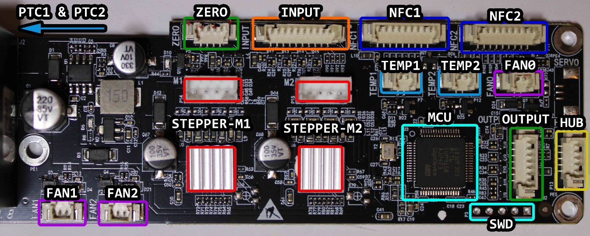
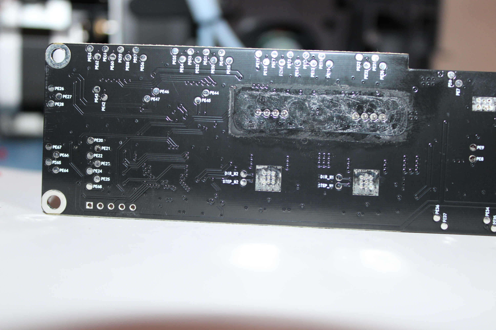
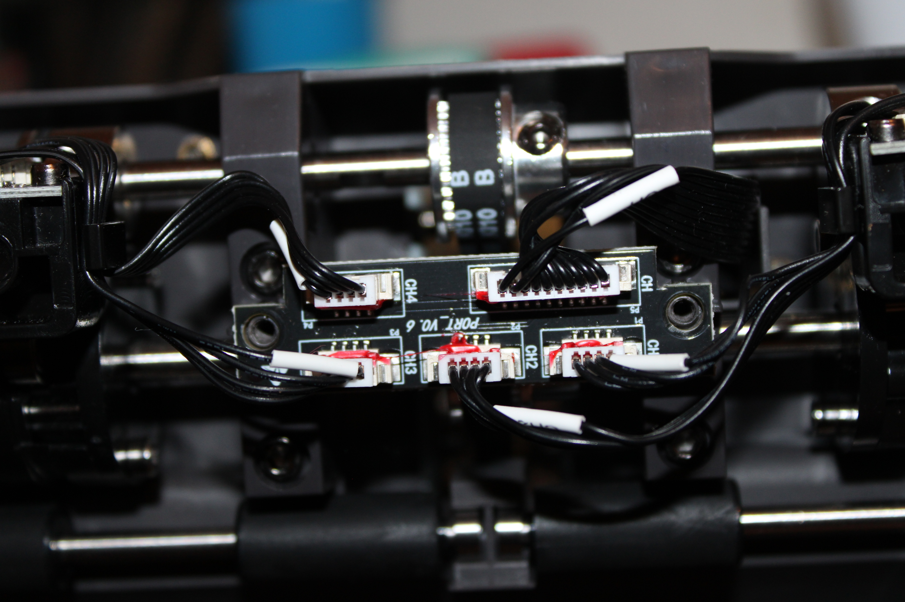
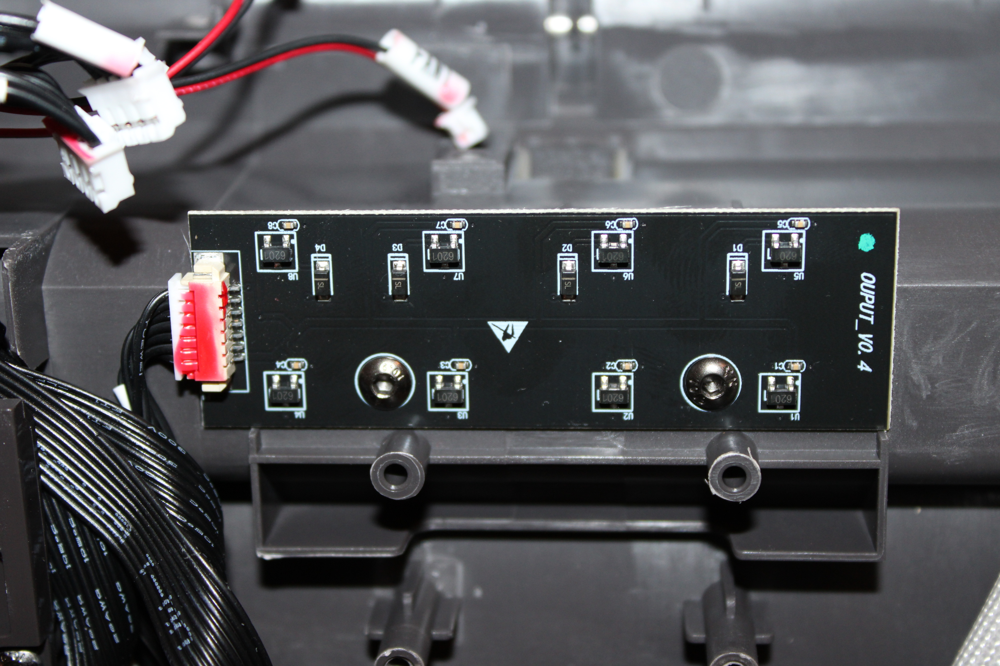
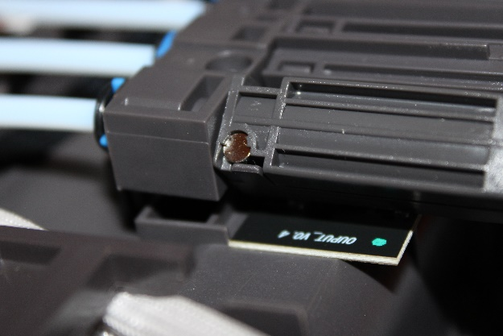
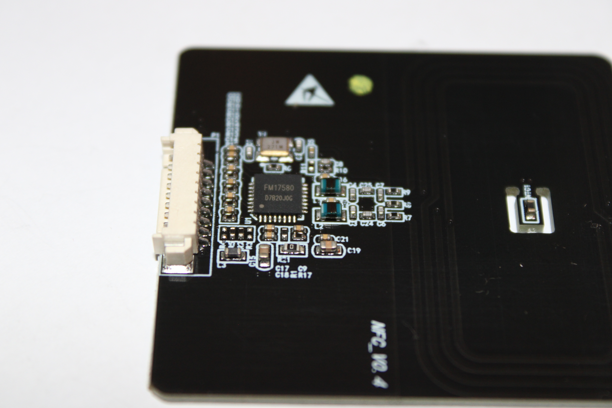
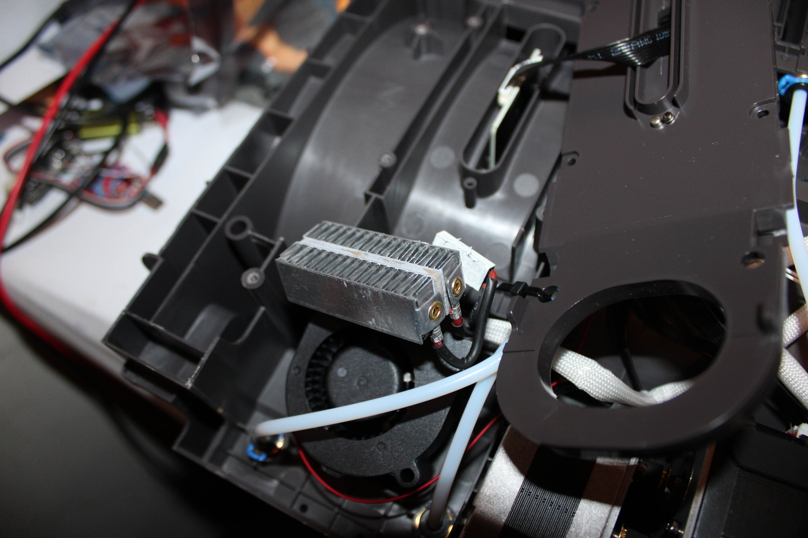

Anycubic ACE Pro Hardware
=========================

**WARNING**: None of this has been tested by me and may be entirely wrong.

Photos
======

The [photos directory](./photos) contains a wide array of internal photos taken
by Tiago-3D. These are released under the CC0.

Motherboard
===========

WARNING: The motherboard contains a mains power supply and may hold a
charge even when unplugged. Handling this board has a risk of electrocution
even when powered off. People will laugh at you for ignoring these warnings.
You've been warned.

The main board for the ACE Pro contains mains input, an AC to DC 24V
power supply and then low voltage logic for handling the ACE Pro.

Two known variants of this board exist:

- FilamentBox_V0.0.8 which uses a HLK-30M240 power supply
- FilamentBox_V0.0.9 which uses a different power supply

The markings on the different supply are hard to read from the photos
(ZWLF-24 something?)

There have been reports of the power supply on the V0.0.8 board failing
and needing a replacement. I don't think Anycubic has posted anything
publicly about this so I won't speculate on the fault.

The motherboard contains a GD32F303 microcontroller used for running the
ACE Pro. A SWD port is available for programming.

Two GC6609 steppers controllers are on the board.

The following connectors are on the board:

- FAN0: Motherboard cooler
- FAN1, FAN2: Dryer fans
- TEMP1, TEMP2: Dryer temperature monitors
- PTC1, PTC2: Dryer heaters
- M1, M2: Filament steppres
- INPUT: Filament detection
, OUTPUT: Filament buffer
- NFC1, NFC2: NFC tag detectors
- HUB: USB hub connector
- ZERO
- SERVO (unpopulated)

USB
===

The connector between the printer and ACE Pro uses a two row, four pin Molex
Microfit connector. Pins are numbered anti-clockwise starting at the bottom
right.

The ACE Pro's female receptacle has the following pinout:

1. 3.5V (unknown purpose and load capability)
2. GND
3. USB D-
4. USB D+

Internally it connects to a GL852G USB 2.0 hub.

A second 6 pin header is connected that exposes another USB port to
connect another ACE Pro in series.

Filament detector
=================

The filament detector mechanism uses four channels (one for each
filament reel) which each have an optical sensor and indicator led.

These all connect to a single PCB labeled PORT_V0.6. This then connects
to the INPUT port on the motherboard.

Buffer board
=============

The filament output of the ACE Pro goes through a buffer mechanism with
two hall effect sensors per filament output. This helps ensure the
filament is actually moving when the steppers move.

This PCB is named OUTPUT_V0.4. It connects to the OUTPUT port on the
motherboard.

NFC readers
===========

The ACE Pro has two NFC reader boards named NFC_V0.4. These each handle
two filament channels. They use a FM17580 chip.

These connect to the NFC ports on the board.

Drying
======

The drying uses two mains powered PTC heating elements with temperature
sensors for regulation. A fan circulates the air and dries filament.

The heater elements are rated for 110VAC (is this a problem for 230VAC
countries?)

The temperature sensor is a BW-S100C NTC thermistor.

The fans are a BCY3010D24H 24V 0.08A DC brushless fan and Coolcox 
BF5020H24S 24V 0.20A DC brushless fan.

Power consumption
=================

Here are some rough measurements of the power this device draws:

- Idle: 7W
- Printing: 12W average (20W peak)
- Drying at 45c: less than 100W average (380W peak)

Steppers
========

No information yet.
